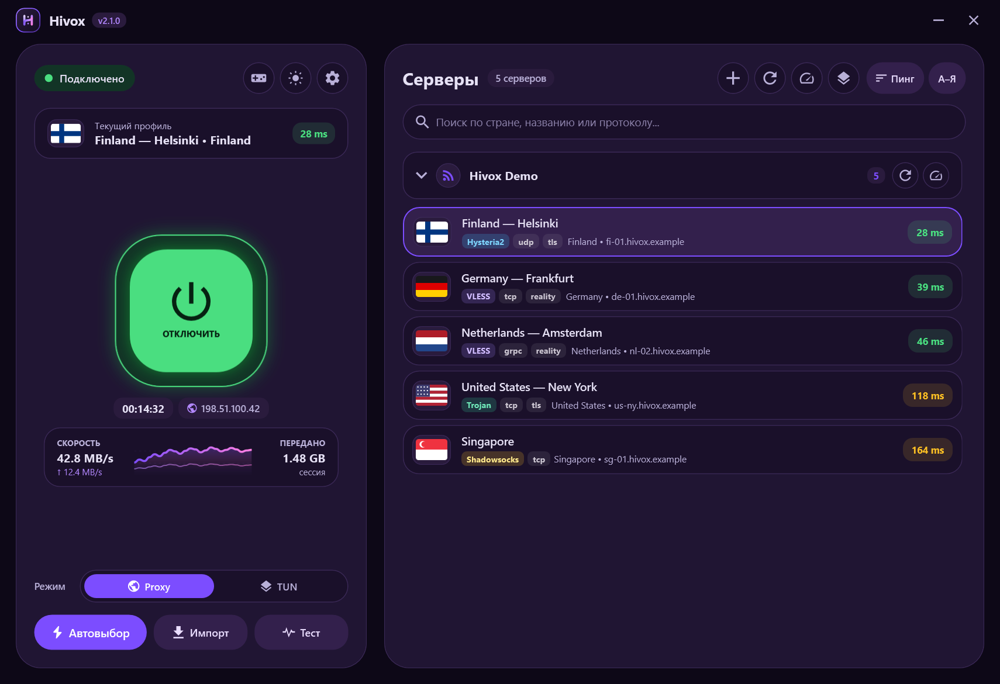
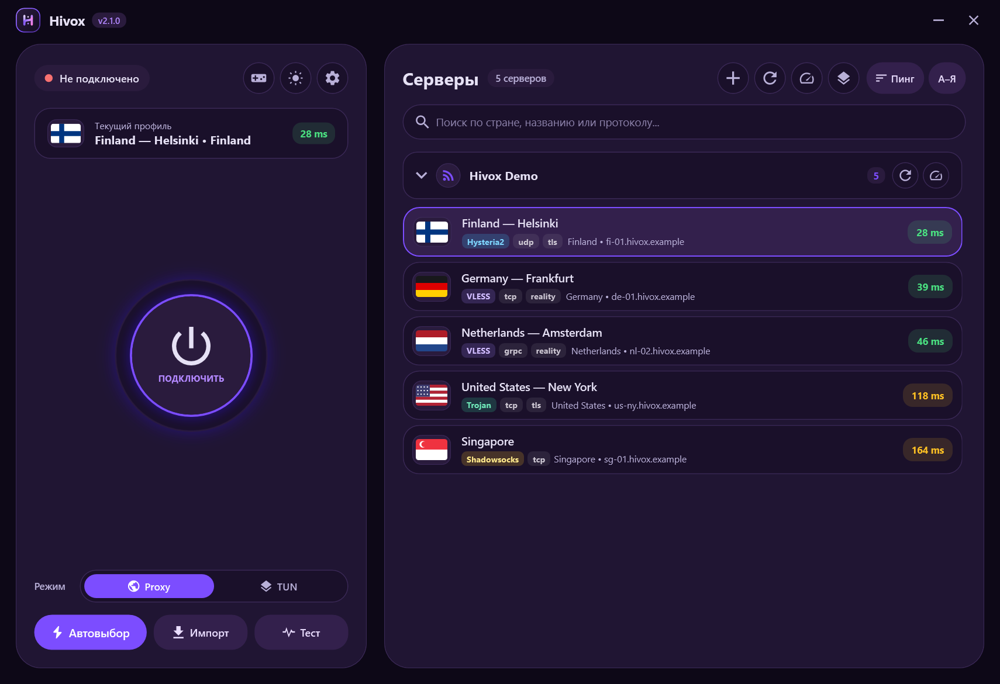

<div align="center">


# Hivox VPN

**Современный кроссплатформенный VPN-клиент для Windows и Android**  
Встроенные ядра **Xray-core** и **sing-box**, режимы **Proxy** и **TUN**, интерфейс в стиле **Material 3**.

[](https://github.com/GagaNojka228/Hivox/releases/latest)
[](https://github.com/GagaNojka228/Hivox/releases)
[-0078D4?style=for-the-badge&logo=windows&logoColor=white)](#скачать-v211)
[](#скачать-v211)

[Интерфейс](#-интерфейс) · [Скачать](#-скачать-v211) · [Возможности](#-возможности) · [Протоколы](#-поддерживаемые-протоколы) · [Быстрый старт](#-быстрый-старт) · [Attestations и SHA-256](#-проверка-подлинности-сборки-attestations-и-sha-256)

</div>

---

## 🖥️ Интерфейс

| Подключено (телеметрия и график скорости) | Главный экран (список серверов) |
| :---: | :---: |
| [](assets/hivox-windows-connected.png) | [](assets/hivox-windows-main.png) |

---

## 📦 Скачать (v2.1.1)

Все актуальные сборки собираются автоматически в **GitHub Actions** с криптографическим подтверждением сборки (**Artifact Attestations**) и доступны на странице [Releases](https://github.com/GagaNojka228/Hivox/releases/latest).

| Платформа | Файл | Описание | Скачать |
| :--- | :--- | :--- | :---: |
| **Windows 10/11 (x64)** | `Hivox-Setup-v2.1.1-win-x64.exe` | Установщик (всё включено) | [Скачать EXE](https://github.com/GagaNojka228/Hivox/releases/download/v2.1.1/Hivox-Setup-v2.1.1-win-x64.exe) |
| **Windows 10/11 (x64)** | `Hivox-Portable-v2.1.1-win-x64.zip` | Портативная версия (без установки) | [Скачать ZIP](https://github.com/GagaNojka228/Hivox/releases/download/v2.1.1/Hivox-Portable-v2.1.1-win-x64.zip) |
| **Android** | `Hivox-v2.1.1-android.apk` | Установочный пакет для смартфона | [Скачать APK](https://github.com/GagaNojka228/Hivox/releases/download/v2.1.1/Hivox-v2.1.1-android.apk) |
| **Checksums** | `SHA256SUMS.txt` | Контрольные суммы файлов | [Скачать TXT](https://github.com/GagaNojka228/Hivox/releases/download/v2.1.1/SHA256SUMS.txt) |

---

## ✨ Возможности

- **Два встроенных ядра:** `Xray-core` и `sing-box` уже упакованы в сборку — ничего дополнительно скачивать не нужно.
- **Режимы работы:** системный **Proxy** (HTTP / SOCKS5) и полноценный **TUN**-режим для всего трафика.
- **Подписки и импорт:** добавление подписок по URL, автообновление по расписанию, массовый импорт ссылок.
- **Умный список серверов:** поиск в реальном времени, сортировка по пингу и имени, проверка доступности (TCP/ICMP), отображение страны (GeoIP).
- **Встроенная диагностика:** тест утечки DNS (*DNS Leak Test*) и замер скорости (*Speed Test*) прямо через активный прокси.
- **Интерфейс Material 3:** тёмная и светлая темы, график скорости в реальном времени, системный трей и история подключений.

---

## 🛡️ Поддерживаемые протоколы

| Протокол | Поддержка | Ядро |
| :--- | :---: | :--- |
| **VLESS** (Reality / Vision / gRPC / WS) | ✅ | Xray-core / sing-box |
| **VMess** | ✅ | Xray-core / sing-box |
| **Trojan** | ✅ | Xray-core / sing-box |
| **Shadowsocks** | ✅ | Xray-core / sing-box |
| **Hysteria2** | ✅ | sing-box |
| **TUIC** | ✅ | sing-box |

---

## 🚀 Быстрый старт

### Windows (x64)
1. Скачайте **`Hivox-Setup-v2.1.1-win-x64.exe`** и запустите установку (либо распакуйте **`Hivox-Portable-v2.1.1-win-x64.zip`** в любую папку и запустите `Hivox.exe`).
2. Нажмите **`+`**, чтобы добавить ссылку на подписку или отдельный сервер.
3. Выберите сервер из списка и нажмите кнопку подключения.

### Android
1. Скачайте **`Hivox-v2.1.1-android.apk`** на телефон и разрешите установку из браузера / файлового менеджера.
2. Откройте **Hivox**, добавьте подписку или конфигурацию.
3. Нажмите кнопку подключения и подтвердите создание VPN-профиля в системе Android.

---

## 🔐 Проверка подлинности сборки (Attestations и SHA-256)

Все релизные файлы начиная с `v2.1.1` собираются в GitHub Actions и подписываются криптографическим подтверждением происхождения (**GitHub Artifact Attestations**). Вы можете проверить, что скачанный файл собран именно из исходного кода этого репозитория:

```bash
gh attestation verify Hivox-Setup-v2.1.1-win-x64.exe --repo GagaNojka228/Hivox
gh attestation verify Hivox-Portable-v2.1.1-win-x64.zip --repo GagaNojka228/Hivox
gh attestation verify Hivox-v2.1.1-android.apk --repo GagaNojka228/Hivox
```

Контрольные суммы SHA-256 для каждого релиза публикуются в файле `SHA256SUMS.txt` на странице [Releases](https://github.com/GagaNojka228/Hivox/releases/latest).

**Проверка SHA-256 в Windows PowerShell:**
```powershell
Get-FileHash .\Hivox-Setup-v2.1.1-win-x64.exe -Algorithm SHA256
```